<div align="center">



<br/>

<a href="https://github.com/rahven-man"></a>
<a href="https://venturi-seven.vercel.app"></a>


</div>

## 01 / THE ENGINEER

I work across **machine learning, data science, statistical computing and data engineering**. I like taking a messy problem, building an analytical workflow around it, and shipping something people can actually use.

```text
FOCUS       Machine Learning · Statistical Computing · Data Engineering
METHOD      Explore → Model → Evaluate → Engineer
PRINCIPLE   Understand the system. Validate the result. Build with intent.
```

<div align="center"></div>

## 02 / SELECTED ENGINEERING

### 01 · VENTURI &nbsp;`FORMULA ONE · ENGINEERING INTELLIGENCE`

<a href="https://venturi-seven.vercel.app">
  
</a>

A Formula One engineering intelligence platform combining historical race data, telemetry analysis, predictive modelling and race-strategy exploration.

- ~72 GB of raw FastF1 data compressed into a compact analytical dataset
- FastF1 + Jolpica integrated for historical race data
- ML models for lap-time prediction, tyre degradation and pit-stop strategy
- Interactive app, deployed live

`Python` `Pandas` `NumPy` `XGBoost` `FastF1` `DuckDB`

<a href="https://venturi-seven.vercel.app"></a>
<a href="https://github.com/rahven-man/Venturi"></a>

<div align="center"></div>

### More work

<table>
<tr>
<td width="50%" valign="top">

**02 · STATISTICAL SIMULATIONS**<br/>
<sub>PROBABILITY / MATHEMATICAL COMPUTING</sub>

Probability and statistics explored through simulation. Birthday problem, theory vs simulated outcomes, numerical analysis.

`Python` `NumPy` `Pandas` `Jupyter`

<a href="https://github.com/rahven-man/statistical-stimulation"></a>

</td>
<td width="50%" valign="top">

**03 · ECHO**<br/>
<sub>PROJECT / EXPLORATION</sub>

Write 2 to 3 lines here about what ECHO does and the tech used.

`Python`

<a href="https://github.com/rahven-man/ECHO"></a>

</td>
</tr>
<tr>
<td width="50%" valign="top">

**04 · SQL PRACTICE**<br/>
<sub>QUERYING / DATA ANALYSIS</sub>

SQL50, DataLemur and interview prep. Joins, CTEs, subqueries, window functions.

`SQL` `MySQL`

<a href="https://github.com/rahven-man/SQL-Practice"></a>

</td>
<td width="50%" valign="top">

**05 · DS / ML INTEGRATION**<br/>
<sub>MACHINE LEARNING / MODEL DEVELOPMENT</sub>

Logistic Regression, Random Forest, XGBoost and Neural Networks, implemented and tested.

`Scikit-learn` `XGBoost` `TensorFlow`

<a href="https://github.com/rahven-man/DS-ML-Integ-Beginning"></a>

</td>
</tr>
</table>

<div align="center"></div>

## 03 / TECHNICAL ARSENAL

<div align="center">


<br/><br/>


</div>

<div align="center"></div>

## 04 / GITHUB TELEMETRY

<div align="center">


<br/>


</div>

<div align="center"></div>

<div align="center">

### BUILD THINGS WORTH UNDERSTANDING.

<sub>RAHVEN / ENGINEERING INTELLIGENCE / BUILT WITH INTENT</sub>

<br/>


</div>
<!--
**rahven-man/rahven-man** is a ✨ _special_ ✨ repository because its `README.md` (this file) appears on your GitHub profile.

Here are some ideas to get you started:

- 🔭 I’m currently working on ...
- 🌱 I’m currently learning ...
- 👯 I’m looking to collaborate on ...
- 🤔 I’m looking for help with ...
- 💬 Ask me about ...
- 📫 How to reach me: ...
- 😄 Pronouns: ...
- ⚡ Fun fact: ...
-->
